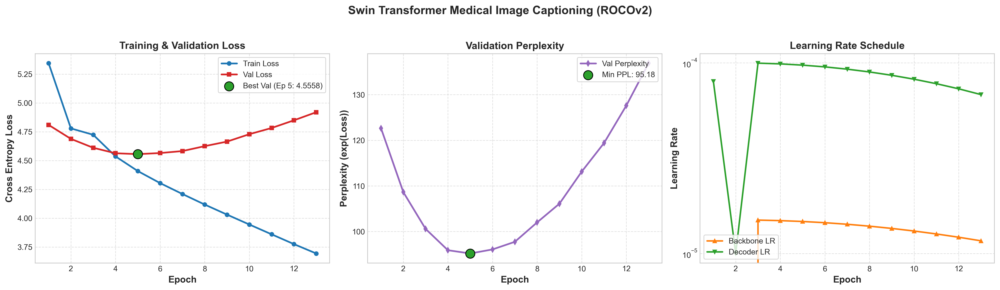
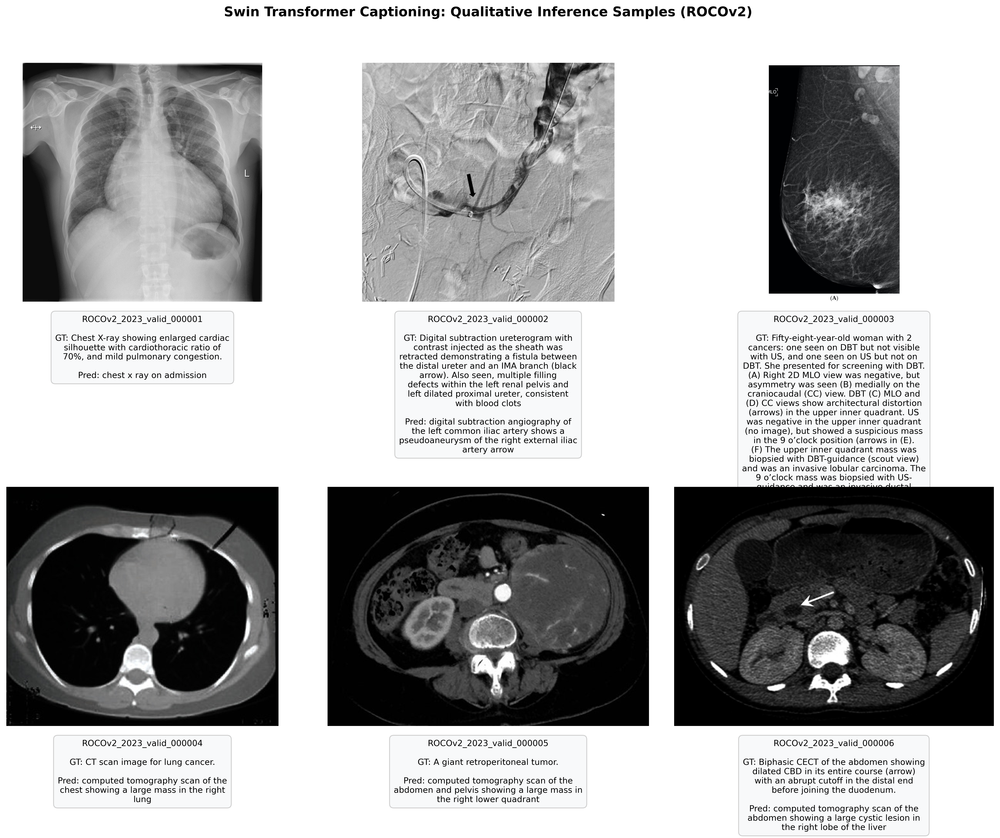

# Swin Transformer vs. CNN–LSTM for Radiology Image Captioning (ROCOv2)

An end-to-end medical image captioning framework built and benchmarked on the **ROCOv2** dataset (59,958 training, 9,904 validation, and 9,927 test image–caption pairs). This repository investigates two distinct architectural paradigms:
1. **Hierarchical Vision Transformer (`Swin-T` + 6-Layer Transformer Decoder)**: Processes $224\times224$ radiographs into 49 spatial visual tokens of dimension 768 via windowed/shifted-window self-attention (W-MSA / SW-MSA), decoded autoregressively with multi-head cross-attention and beam search.
2. **Classical Pretrained Baseline (`CNN+LSTM/`)**: Pairs an ImageNet-pretrained ResNet-50 visual feature extractor with a recurrent LSTM decoder.

---

## Key Architectural & Training Highlights

- **Two-Phase Transfer Learning**:
  - **Phase 1 (Epochs 1–2 — Decoder Warmup):** The Swin encoder is frozen while the 6-layer Transformer decoder warms up at `lr = 1.5e-4`, aligning cross-attention weights without distorting visual representations.
  - **Phase 2 (Epochs 3+ — End-to-End Fine-Tuning):** Unfreezes the Swin backbone with differential learning rates (`1.5e-5` for the visual encoder, `1.0e-4` for the decoder) and proper weight-decay exclusion on 1-D norms, biases, and positional tables.
- **Anti-Collapse Regularization**:
  - **Vocabulary Pruning (`min_freq = 5`):** Filters rare OCR typos and noise, yielding a clean 8,729-token clinical vocabulary.
  - **Word Dropout ($p = 0.10$) & Decoder Dropout ($0.20$):** Randomly masks input tokens with `<unk>` during teacher forcing to force the decoder to ground predictions in the 49 visual memory tokens.
- **Beam Search Decoding**:
  - Length-normalized beam search ($k = 3, 4$) with trigram repetition blocking.

---

## Benchmark Results on ROCOv2

| Model Architecture | BLEU-1 | BLEU-2 | BLEU-3 | BLEU-4 | ROUGE-L | CIDEr-D | Distinct Captions |
| :--- | :---: | :---: | :---: | :---: | :---: | :---: | :---: |
| **Swin-T (From-Scratch, 2k subset)** | 0.1097 | 0.0560 | 0.0251 | 0.0089 | 0.1335 | 0.0927 | 18.3% |
| **Swin-T (From-Scratch, 5k subset)** | 0.1320 | 0.0631 | 0.0302 | 0.0103 | 0.1335 | 0.1254 | 20.8% |
| **Swin-T (From-Scratch, Full 60k)** | 0.1671 | 0.0871 | 0.0485 | 0.0289 | 0.1960 | — | — |
| **CNN–LSTM Baseline (ResNet-50 + LSTM)** | **0.2105** | 0.1098 | 0.0624 | 0.0377 | 0.1953 | — | 44.0% |
| **Swin-T (Pretrained + 2-Phase, Beam-4)** | 0.1833 | **0.1099** | **0.0644** | **0.0379** | **0.2160** | **0.3438** | **79.8%** |

### Training Dynamics & Qualitative Predictions





---

## Repository Structure

```text
swin-transformer-2k-images/
├── caption_model.py            # SwinCaptioningModel (Pretrained & Custom Swin + Beam Search)
├── swin_model.py               # From-scratch Swin-T encoder implementation (W-MSA / SW-MSA)
├── decoder_model.py            # 6-layer causal Transformer decoder with cross-attention
├── dataset.py                  # ROCOv2 dataset loader and image augmentations
├── vocab.py                    # Word-level clinical tokenizer and vocabulary builder
├── train.py                    # Two-phase training loop, AMP mixed precision, live plotting
├── eval.py                     # Corpus BLEU-1..4, ROUGE-L, CIDEr-D & diversity evaluator
├── generate.py                 # Single-image caption generation utility
├── metrics.py                  # Self-contained BLEU, ROUGE-L, and CIDEr-D implementations
├── plot_training.py            # High-resolution loss, perplexity, and LR curve generator
├── visualize_inferences.py     # Qualitative prediction card grid generator
├── figures/                    # Generated training curves and qualitative sample grids
├── artifacts/                  # Exported sample predictions CSV
├── CNN+LSTM/                   # Pretrained ResNet-50 + LSTM baseline pipeline & results
├── paper/                      # IEEE conference paper LaTeX source, figures, and compiled PDF
└── report_latex/               # Detailed architectural derivation report
```

---

## Dataset Configuration

By default, the scripts look for ROCOv2 at:
```text
C:\AIE Files\Projects\S5\Dl\DATA\rocov2
```
Expected structure:
- `train_captions.csv`, `valid_captions.csv`, `test_captions.csv` (columns: `ID`, `Caption`)
- `train_images\train\`, `valid_images\valid\`, `test_images\test\`

*(To override the dataset path, set the `ROCO_ROOT` environment variable or pass `--root` to `eval.py`.)*

---

## How to Run

### 1. Activate Environment
```powershell
conda activate rtx_gpu
cd "C:\AIE Files\Projects\S5\Dl\swin-transformer-2k-images-"
```

### 2. Train the Model (Two-Phase Pipeline)
```powershell
python train.py --epochs 30 --batch_size 32
```
- Saves `swin_caption_best.pt` and `swin_caption_last.pt` in `ROCO_ROOT` (excluded from Git via `.gitignore` due to size).
- Automatically updates `training_history.json`, `training_history.csv`, and `figures/swin_training_curves.png` after every epoch.
- **Resume an interrupted run:**
  ```powershell
  python train.py --resume
  ```

### 3. Evaluate on Held-Out Test Split
```powershell
python eval.py "C:\AIE Files\Projects\S5\Dl\DATA\rocov2\swin_caption_best.pt" --split test --n 500 --beam 4
```
*(Pass `--n 0` to evaluate on all 9,927 test images.)*

### 4. Generate Qualitative Inference Cards
```powershell
python visualize_inferences.py --n 6 --beam 3
```
Saves the visual comparison grid to `figures/swin_qualitative_predictions.png` and tabular outputs to `artifacts/swin_sample_predictions.csv`.

